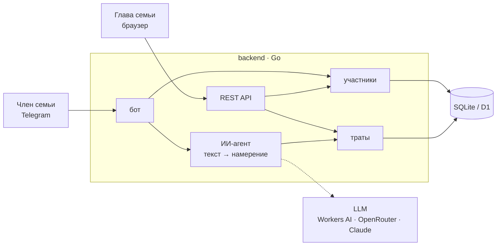

# ИИ-бот учёта семейных расходов

Пишешь боту «кофе 350» или «такси пятихатка вчера», и трата сохраняется: сумму, категорию и дату определяет ИИ. Глава семьи видит траты всех в веб-панели.

   

## Попробовать

- **Бот:** [@tttrrraaacckeeerrr_bot](https://t.me/tttrrraaacckeeerrr_bot). Первое сообщение создаёт заявку, после одобрения в панели можно писать траты.
- **Веб-панель:** https://expense-bot.321free123.workers.dev. Пароль выдаётся лично.

> Демо работает на бесплатном тарифе Cloudflare. Изредка возможны ошибки (`1102` — превышен лимит CPU) или ответ «ИИ на сегодня исчерпал бесплатный лимит». Помогает повторить через минуту или на следующий день. Подробнее в [docs/deploy.md](docs/deploy.md).

## Запуск

**Docker:** `cp .env.example .env`, заполнить пароль, токен бота и ИИ, затем `docker compose up -d --build`. Панель откроется на http://localhost:8080.

**Бесплатно на Cloudflare:** Worker на Go, D1 и Workers AI, 0 ₽ в месяц, см. [docs/deploy.md](docs/deploy.md).

## Главное

- **Только свои траты:** владелец берётся из Telegram, а не от ИИ, и каждый SQL-запрос ограничен им.
- **Участников одобряет глава семьи:** чужие не доходят до ИИ.
- **ИИ только разбирает текст.** Суммы, даты и ответы считает код, сленг вроде «косарь» и «пятихатка» переводится в цифры до модели. Тест на 42 трудных фразах пройден полностью.

## Документация

| | |
|---|---|
| [Архитектура](docs/architecture.md) | слои, структура кода, как добавить БД или модель |
| [ИИ-агент](docs/agent.md) | как разбирается текст, сравнение моделей, eval |
| [Безопасность](docs/security.md) | изоляция данных, одобрение участников, лимиты |
| [Запуск и настройки](docs/deploy.md) | Docker, Cloudflare, переменные окружения |
| [REST API](docs/api.md) | эндпоинты панели |
| [Работа с ИИ-ассистентом](docs/ai-assistant.md) | как проект делался с Claude Code |

Для ИИ-агентов: как устроен код и как вносить изменения — в [CLAUDE.md](CLAUDE.md).
