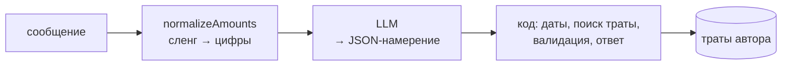

# ИИ-агент

Модель не выполняет действий: она только превращает сообщение в JSON-намерение. Остальное делает код.



```json
{"action":"update","target":{"last":true,"amount":350},"changes":{"amount":450}}
```

## Что делает код, а не модель

- **Сленг в суммах** (`usecase/amounts.go`), до модели, поэтому одинаково для любой модели:

  | Пишут | Модель видит |
  |---|---|
  | пятихатка, сотка, полтыщи | 500, 100, 500 |
  | косарь, полторы, полтора косаря | 1000, 1500, 1500 |
  | двушка, трёшка, пятера, шестера, десятка | 2000, 3000, 5000, 6000, 10000 |
  | 2к, 1.5к, 80 тыс, 2 косаря, 12 500, 99,90 | 2000, 1500, 80000, 2000, 12500, 99.90 |
  | кофе 20 | 20: голые числа не трогаются |

  Если в сообщении есть цифры, сленговые слова не заменяются: в «аренда двушки 40к» «двушка» — квартира. Суммы словами («две тысячи триста», «четыре с половиной косаря») разбирает модель.
- **Периоды.** Модель выбирает только название (`this_month`, `last_7_days`…), границы дат считает код. Для «вчера» и «в пятницу» модель получает календарь на неделю.
- **Поиск траты** для изменения или удаления идёт среди трат автора: «последняя», по сумме, по началу слов (переживает опечатки). Если подходят несколько, бот переспрашивает и наугад ничего не удаляет.
- **Ответы** формирует код из данных БД, поэтому суммы в них не выдуманы.

## Выбор модели (eval)

`make eval` гоняет настоящую модель по 42 трудным фразам: опечатки, сленг, даты, неочевидные категории, несколько трат в одном сообщении, инъекции. Есть и текст на 499 символов с пятью тратами, где сумма и то, за что заплачено, стоят в разных предложениях.

| Модель (Workers AI, бесплатно) | Результат | Время | Нейронов на сообщение |
|---|---|---|---|
| **Gemma 4 26B** — используется | **42/42** | 2.3 с | 4–8 |
| GLM-4.7-flash | 41/42 | 5.2 с | ≈5 |
| Granite 4.0 micro | 35/41 | 1.4 с | ≈2 |
| gpt-oss-20b | 34/41 | 3.0 с | — |
| Llama 3.2 3B / 3.1 8B / 3.2 1B | 32 / 27 / 20 из 41 | < 2.5 с | — |
| Qwen3 30B | 0/41 (вместо JSON думает вслух) | — | — |

Дешёвые модели путают категории и даты, поэтому выбрана Gemma 4: точная, быстрая, около 2000 сообщений в день в бесплатной квоте.

## Провайдеры

Выбираются через `LLM_PROVIDER`:

- **`openai`** — любой OpenAI-совместимый API: Workers AI по REST (бесплатно), DeepSeek напрямую, OpenAI, Ollama.
- **`openrouter`** — тот же адаптер с адресом OpenRouter: сотни моделей по одному ключу, наценки на токены нет, около 5% комиссии при пополнении.
- **`anthropic`** — Claude через официальный SDK. Только на сервере: в Worker SDK не влезает по размеру.
- **`workersai`** — binding внутри Cloudflare Worker, без ключей.

Параметры конкретной модели передаются через `LLM_EXTRA_BODY` без правок кода. Например, у Gemma 4 так отключаются «размышления».
