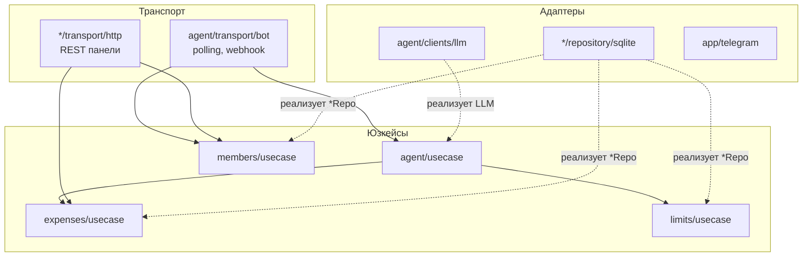

# Архитектура

Код разбит по доменам. Внутри каждого домена слои: интерфейсы → юзкейсы → репозитории и транспорт. Зависимости направлены внутрь: юзкейс знает только интерфейсы, реализации подставляет `server/app.go`.



## Структура

```
backend/
  cmd/server            VPS / docker: HTTP-сервер, бот (polling или webhook), файл SQLite
  cmd/worker            Cloudflare Worker (Go → wasm): D1, Workers AI, вебхук
  config/               настройки из env (одинаково на сервере и в Worker)
  migrations/           схема для goose; для D1 берётся только секция Up
  server/app.go         сборка приложения для обеих точек входа
  internal/
    app/                общее: apperr, clock, http (Router, Doer), sqlite, telegram
    expenses/           траты
    members/            участники семьи и их одобрение
    agent/              ИИ-агент и транспорт бота
    limits/             счётчики лимитов
    auth/               вход в панель
web/                    панель: React + Vite + TypeScript
deploy/cloudflare/      wrangler.toml и сборка конфига
```

Внутри домена (на примере `expenses`):

```
expenses/
  errors.go            ошибки домена (apperr с кодом not_found / validation)
  repository.go        интерфейс ExpensesRepo
  usecase.go           интерфейс ExpensesUseCase
  models/              модели и их валидация
  usecase/             реализация юзкейса
  repository/sqlite/expense/   entity.go · queries.go · mappers.go · expenses.go
  transport/http/admin/        handlers.go · dto.go · mappers.go · expenses.go
```

Мапперы стоят на каждой границе: entity ↔ модель в репозитории, DTO ↔ модель в транспорте, ответ ИИ → модель в агенте.

## Как расширять

- **Другая БД.** Нужна новая папка `repository/<бд>/` с реализацией интерфейсов `*Repo` и подключение в `server/app.go`. Юзкейсы не меняются.
- **Новая модель ИИ.** Большинство моделей подключаются конфигом через OpenAI-совместимый адаптер (OpenRouter, DeepSeek, Ollama). Для своего API нужен файл в `agent/clients/llm` с методом `Complete`.
- **Другой мессенджер** — ещё один транспорт рядом с `agent/transport/bot`, вызывающий тот же `AgentUseCase`.
- **Несколько семей.** «Семья» добавится в `Scope` рядом с пользователем. Каждый запрос к тратам уже начинается с `whereScope`, так что фильтр по семье встанет в одно место.

## Почему так

- **SQLite.** Данных у семьи мало, а D1 на Cloudflare — тоже SQLite. Один SQL и одни репозитории работают и в Docker, и в бесплатном Worker.
- **Один код на сервер и Worker.** Точки входа передают в `server.New` только БД и HTTP-клиент.
- **HTTP-клиент через интерфейс `Do`.** С `*http.Client` в Worker линкуется `http.DefaultTransport`, а это +1.3 МБ при лимите 3 МБ.
- **Свой роутер (`app/http/router.go`).** Worker собирается TinyGo, а там своя копия `net/http`, где `ServeMux` не понимает шаблоны вида `GET /api/{id}`. Роутер на 60 строк одинаково работает в обоих компиляторах.
